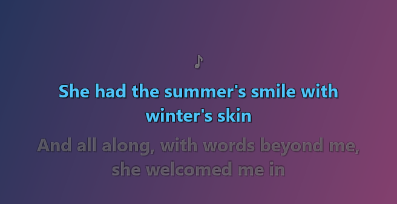
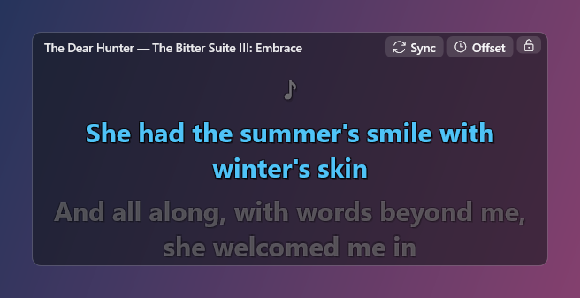

# sp-lyrics-rs

A tiny always-on-top, transparent synced-lyrics overlay for Spotify on Windows (a MiniLyrics replacement), written in Rust.
It's a single portable `sp-lyrics-rs.exe` (~410 KB) that needs no runtime or DLLs, uses about 10 MB of RAM and stays well under 1% CPU.



Hovering over the unlocked overlay shows the track and a small toolbar:



## Use

1. Put `sp-lyrics-rs.exe` anywhere with an `lrc` folder next to it, or pick another folder from the menu.
2. Name lyric files `artist - title.lrc`. Matching is fuzzy and handles case, punctuation, `&`/`and`,
   `(feat. …)`, `- Remastered 2011`, `[Live]`, multiple artists and swapped `title - artist` names.
   A file named just `title.lrc` also matches.
3. Run it and play something in the Spotify desktop app.

Synced `.lrc` files are supported, including `[mm:ss.xx]` stamps, several stamps per line, enhanced `<mm:ss.xx>` word stamps and `[offset:]`.
Plain text files without timestamps scroll evenly across the song.
New or edited files are picked up automatically within about 2 seconds.

## Controls

| Action | How |
|---|---|
| Move / resize | Drag the overlay / drag its edges (when unlocked) |
| Menu | Right-click the overlay or the tray icon |
| Lock (click-through) / unlock | Hover → padlock button (top-right). While locked, only a faint padlock appears on hover and everything else passes clicks through. |
| Fix timing for the current song | Hover → **Offset**, then mouse wheel or −/+ (0.1 s steps, saved into the `.lrc` as `[offset:]`). Plain scrolling does nothing until Offset is clicked, and offset mode ends when the mouse leaves the overlay. |
| Hide / show the lyrics | Hover → minimize button (next to the padlock), right-click → *Hide lyrics*, or left-click the **tray icon**. While minimized nothing is shown and the whole overlay passes clicks through. To bring the lyrics back, left-click the **tray icon** (or use *Hide lyrics* in its right-click menu). The state is remembered between restarts. |
| Text size | Ctrl + mouse wheel |
| Start with Windows | Right-click → *Start with Windows* (per-user startup entry, no admin needed; untick it before moving or deleting the exe) |

### Syncing lyrics by tapping (sync mode)

For a plain-text `.lrc` without timestamps, or to redo bad timing:

1. Hover the overlay → **Sync**, or right-click → *Sync timing by tapping Space…*. The song restarts from the beginning.
2. Press **Space** the moment each highlighted line starts. **Backspace** undoes the last tap and rewinds a little.
   **Esc** cancels without saving.
3. After the last line is tapped, the same `.lrc` file is updated in place with the timings.
   To stop early, click **Save now** (toolbar) or right-click → *Save sync now*. Tapped lines are saved with timestamps,
   and the rest stay as plain text below them. The toolbar then shows **Resume sync**, which seeks to just before the last
   timed line and continues from the first untimed one. A partly synced file plays synced up to its last timed line.

### Try it with the example

[`examples/amazing grace.lrc`](examples/amazing%20grace.lrc) holds John Newton's 1779 hymn, which is in the public domain.
It's plain text, so you can practise sync mode on it:

1. Copy it into your `lrc` folder. The filename has no artist, so it matches **any** Spotify recording titled "Amazing Grace".
2. Play a traditional recording. Recordings sing different verses, so delete any verse yours skips
   (right-click → *Edit current .lrc*). Avoid modern rewrites like *Amazing Grace (My Chains Are Gone)*, which add other lyrics.
3. Hover → **Sync** and tap Space as each line starts.

Space, Backspace and Esc are captured system-wide only while sync mode is active, so tapping works even while Spotify has focus.
If Spotify refuses the restart, seek to 0:00 yourself, then start tapping.

Settings (colors, font, global `offset_ms`, followed player) live in `sp-lyrics-rs.ini` next to the exe.
Leave `player=` empty to follow any media player that reports to Windows, such as a browser or foobar2000.

To debug matching, create an empty `sp-lyrics-rs.log` next to the exe. Each lookup is then logged there.

## Build

Requires Rust with the MSVC toolchain.

```
cargo build --release
```

Output: `target\release\sp-lyrics-rs.exe`, with the C runtime statically linked.

## How it works

- The current track and play position come from Windows' media session API (`GlobalSystemMediaTransportControls`),
  which Spotify desktop publishes to. It needs no Spotify login or API key and makes no network requests.
- Text is drawn with Direct2D/DirectWrite into a per-pixel-alpha layered window.

## License

[MIT](LICENSE).

Toolbar icons are drawn from **Segoe Fluent Icons** (Windows 11) / **Segoe MDL2 Assets** (Windows 10), fonts that ship
with Windows. They're used at runtime, not bundled or redistributed.
